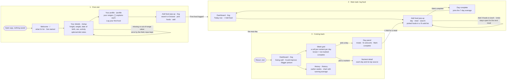

# Diet Tracker

A diet tracker for keeping a **balanced diet** and maintaining your weight, not losing it. Enter a few details about yourself once, and it sets target ranges for calories, macros, fiber and key vitamins and minerals. Log what you eat, mark the day complete, and see how each nutrient averages out over your last 7 days, with suggestions in plain words.

Built for MPCS 51238 *Design, Build, Ship*, Assignment 3: Patterns & Flows.

**Live app:** _Vercel URL to add_ · **Process write-up:** [`docs/process-writeup.pdf`](docs/process-writeup.pdf)

> **For graders:** the app is built for weeks of use. On the Profile page, **Load a sample 2 weeks** fills the 15 days before today with example meals, so you can see the Dashboard, suggestions and History as they look in the long run without entering dozens of foods. **Clear sample data** removes it again.

## The main task, in one sentence

> I log what I ate today → it joins my last 7 days once I mark the day complete → I come back tomorrow, and the Dashboard shows what's going well and what to eat more of.

## User flows

Three flows: the first visit, the main task, and coming back. Each step is its own page. Routes, states, errors and the full table of targets are in [`flows.md`](flows.md). A PDF of the chart is in [`user-flows.pdf`](user-flows.pdf).



## How it works

- **No account.** Everything is saved in your browser (`localStorage`), so it remembers you on the device you used. No database, server or external APIs.
- **Targets** are estimates for maintaining your weight (National Academies equations and dietary guidelines; sources in `research/nutrition-targets.md`), not medical advice. Ten nutrients: calories, protein, carbs, fat, fiber, potassium, calcium, iron, vitamin A and vitamin C.
- **A rolling 7-day window.** Each nutrient is judged on its average over the last 7 days, not on one day. A day counts only once you mark it complete; unlogged days are left out, not counted as zero.
- **The first week unlocks in stages:** averages after your first complete day, suggestions after 3.
- **Pages:** Dashboard (`/log`), History, Profile and FAQ in the shared nav; Recipes and Edit details link back to their section.
- **Accessibility:** every control works with a keyboard and has a visible focus ring; every field has a real label; text contrast is checked against WCAG AA (values in `design.md`).

## Run it locally

```bash
npm install
npm run dev
```

Then open http://localhost:3000.

Stack: Next.js, Tailwind CSS and TypeScript, deployed on Vercel.

## Onboarding research

Three research agents studied how **MyFitnessPal**, **MyNetDiary** and **Noom** welcome someone new. Full notes and sources are in [`research/onboarding-research.md`](research/onboarding-research.md).

**What they do**
- **Value comes late.** All three put a long quiz (18 to 113 screens), and usually a signup and paywall, before anything useful. Noom takes 10–15 minutes and shows a paywall with a countdown before you see the app.
- **Weight loss is the default.** Maintenance is a side option.
- **Many nutrients get shown a few at a time.** MyNetDiary expands the full vitamin list on tap; MyFitnessPal has a weekly-average view.
- **People dislike** streaks that reset, celebrations they can't dismiss, paywalled basics, cluttered dashboards with tooltip tours, and good-vs-bad food colors.

**What we're borrowing**
- **First visit:** six fields on one screen, then straight to your ranges and a one-tap first log, in about a minute. A "why we ask" hint on sensitive fields (Noom). ⓘ info buttons that explain each range and how it was calculated. An inline "First food logged" message (MyFitnessPal).
- **Logging:** one-tap add with Undo, and your last serving size remembered (MyFitnessPal, MyNetDiary). Bars that show grams and what's left. "What it adds" tags instead of good/bad colors.
- **Coming back:** suggestions with a one-tap fix. Mark a day complete, so half-logged days don't skew the numbers (MyNetDiary). A weekend vs. weekday trend. Days logged instead of streaks. And our own idea: a **rolling 7-day balance** instead of fixed weeks.
- **Later, while building:** suggestions became three tiles in plain words (advice instead of one-tap "Add a banana" buttons), the weekend vs. weekday trend was dropped for time, and "why we ask" notes moved behind ⓘ buttons.

**What we're avoiding:** long quizzes, signup or paywall walls, fake "building your plan" loaders, countdown timers, streaks that reset, and good/bad food labels.

## First-run check

**How it was run (Oct 20).** Four agents used the app as real people would, each in its own browser tab and on its own address (`first-web.localhost`, `returning-mobile.localhost` and so on), so each had separate, empty saved data:

| Tester | Device | Goal |
|---|---|---|
| First-time user | Laptop browser | Understand the app, set up, log a first meal, explore |
| First-time user | 390px phone frame | The same, one-handed, checking for sideways scroll |
| Returning user | Laptop browser | After two weeks of (sample) use: read the week, catch up on a missed day, use History and Recipes |
| Returning user | 390px phone frame | The same daily routine on a phone |

They ran on the development build, the same code that deploys. The phone frame matches a phone's width but has no touch or on-screen keyboard, so phone-specific bugs were checked on a real phone afterward.

**What worked.** All four understood the app from the welcome card and got personal ranges in about a minute. Setup errors sat next to the field, said what to do ("Enter a weight between 70 and 700 lb.") and kept what was typed. The ⓘ explanations, logging several foods at once, the clear 7-day window ("Tue, Oct 13 – Mon, Oct 19"), the nutrient detail table and History's running average all landed. There were no console errors, and keyboard focus was always visible.

**What they found, and what changed**

| Feedback | Change |
|---|---|
| Leaving Add food (Escape, the backdrop, Close, New recipe) silently threw away picked foods (3 of 4) | The "To add" list is kept for the tab; the button shows "Add food · 2 picked". Escape in the search closes only the suggestions |
| Remove in a day's panel had no visible Undo: the message was behind the panel's backdrop (3 of 4) | Undo messages show inside the open pop-up or panel; focus moves to the next food |
| On a phone, the week grid scrolled sideways and lost the nutrient names; the nutrient detail was cut off (both phone testers) | Phones show three days at a time with ‹ › arrows, opening on the newest; the detail fits the screen; History's tooltip stays on screen |
| "Log your first food" went to the Dashboard instead of opening Add food (2 of 4) | It opens Add food directly (`/log?add=1`), as does Recipes' log link |
| Recipes and Edit details had no way back and no nav item highlighted (3 of 4) | Back links, and the nav marks their section |
| Faded "not complete" days looked like "Under" yellow; decorative stickers read as status colors (2 of 4) | Not-complete days are brown-bag kraft cells; stickers show food facts in each food's own color |
| "Based on 6 days so far" read like a first-week message after two weeks | Moved behind an ⓘ next to Average: "6 of 7 days count so far…" |
| A shown "31 g" against "at least 31 g" was marked Under | Status judges the rounded number shown |
| Smaller: pregnancy wording shown to men, a "pick one below" hint with nothing below, first-run wording on Edit details, tag colors changing by position | All fixed |

From my own use alongside the testers: Add food now stays open after adding a meal, with Mark complete inside it, so a whole day can be logged at once; the date of birth can be typed ("e.g. 02/19/1995"); and the setup's "why we ask" notes moved behind ⓘ buttons.

**Heard but not changed (my call).** Sodium and a recipe's "makes N servings" field were removed on purpose to keep logging simple. A prompt before marking a light day complete is still under consideration.
