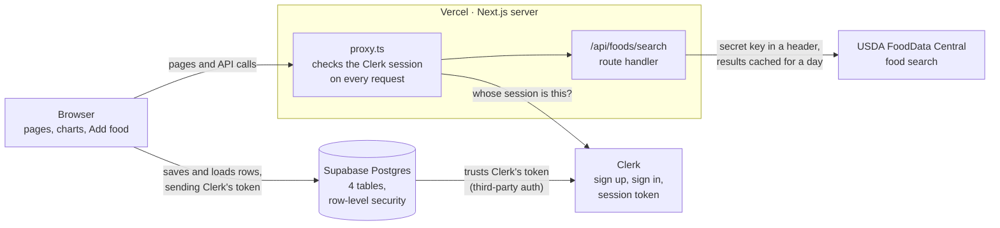

# Keep Level

A diet tracker for keeping a **balanced diet** and maintaining your weight, not losing it. Enter a few details about yourself once, and it sets target ranges for calories, macros, fiber, key vitamins and minerals, and sodium. Log what you eat, mark the day complete, and see how each nutrient averages out over your last 7 days, with suggestions in plain words.

Built for MPCS 51238 *Design, Build, Ship*. Assignment 3 made the flows and screens; **Assignment 4 (Full Stack App)** adds accounts, a database, an external API, a security test and a live deploy.

**Live app:** _Vercel URL to add_ · **Code:** this repository (work on branch `assignment-4`, merged to `main` for the deploy) · **Assignment 3 process write-up:** [`docs/process-writeup.pdf`](docs/process-writeup.pdf)

> **For graders:** sign up with your own email (Clerk sends a verification code). Your data is yours alone: nobody else, including other test accounts, can see it. The app is built for weeks of use, so on the Profile page **Load a sample 2 weeks** fills the 15 days before today with example meals, and **Clear sample data** removes them. Search in **Add food** also looks up USDA FoodData Central.

## The main task, in one sentence

> I log what I ate today → it joins my last 7 days once I mark the day complete → I come back tomorrow, and the Dashboard shows what's going well and what to eat more of.

## Assignment 4 at a glance

| Requirement | How it's met, and where to look |
|---|---|
| **Accounts** | Clerk handles sign up, sign in and sign out. `proxy.ts` sends a signed-out visit to any page except `/`, `/faq`, `/sign-in` and `/sign-up` to sign in, and answers signed-out API calls with 401. Pages: `app/sign-in`, `app/sign-up`, `components/AccountButtons.tsx`. |
| **Data** | Four Supabase tables (`profiles`, `my_foods`, `log_entries`, `complete_days`), each with row-level security. Migrations are in `supabase/migrations/`; all reads and writes go through `lib/storage.ts`. |
| **API** | USDA FoodData Central, called only from our server (`app/api/foods/search/route.ts`). Add food shows loading, nothing-found and API-down states. |
| **Persistence** | Everything a person saves is rows in Supabase tied to their account, so it's there after signing out and back in, on any device. Browser storage only holds the unsaved "To add" list for the current tab. |
| **Keys** | In `.env.local` (git-ignored) and Vercel's environment variables, never in code. `.claude/settings.json` denies the agent reading `.env` files. Secret keys have no `NEXT_PUBLIC_` prefix and run only on the server. |
| **Test** | One Playwright test: two users sign in, each saves a food, neither can see the other's. Watched failing, then passing (below). |
| **Review** | `/security-review` run on the branch before merging (result below). |
| **Deployed** | Live on Vercel (URL above), where a classmate can make an account and use it. See "Deploy". |
| **UI/UX** | The Assignment 3 flows, forms, navigation and accessibility carry on; see "User flows" and `design.md`. |

## Architecture



The browser talks to Supabase directly with the person's Clerk token, so the database itself decides what each person may see. The only call that goes through our server is food search, because that one needs a secret key.

## What happens when someone saves a food

1. **Browser:** tapping Add updates the screen at once. `lib/storage.ts` compares the new data with the old and finds the one new `log_entries` row.
2. **To Supabase:** the browser's Supabase client (`lib/supabase.ts`) sends the insert with the person's Clerk session token. The row carries no `user_id`.
3. **At Supabase:** Supabase checks the token against Clerk, reads the person's id (the token's `sub`), and the column default fills `user_id` with it. The row-level security policy then checks `user_id` equals that same id, and the row is saved.
4. **If it fails:** the screen shows a message and reloads from the database, so it never shows something that wasn't saved.

Food **search** is different: the browser calls `/api/foods/search` on our server. `proxy.ts` checks the Clerk session first (signed out gets a 401). The route then calls USDA with the secret key and returns trimmed results, cached for a day.

## Who sees what: the data model and row-level security

| Table | One row is… | Notes |
|---|---|---|
| `profiles` | a person's setup details | height, weight, date of birth, sex, activity, allergies, eating pattern, pregnancy or breastfeeding |
| `my_foods` | a food they saved | USDA foods (per 100 g, with household portions) and recipes they built |
| `log_entries` | one food eaten | date, meal, amount, and its nutrients copied at logging time |
| `complete_days` | a day marked complete | primary key `(user_id, date)` |

Every table has a `user_id` (the Clerk user id, as text) that the database fills in from the token, and **row-level security is on for every table** with one policy each:

```sql
create policy "Own log entries" on public.log_entries for all to authenticated
  using (user_id = (select auth.jwt() ->> 'sub'))
  with check (user_id = (select auth.jwt() ->> 'sub'));
```

In plain words: a signed-in person can read, add, change and delete a row only if its `user_id` is their own id. A signed-out visitor (the `anon` role) has no access to any table. Loads deliberately have no `user_id` filter in the app, so the database is the only thing deciding what comes back. The full model is in `AGENTS.md`.

## The external API

USDA FoodData Central (Foundation, SR Legacy and survey foods), searched from **Add food** under "More from USDA".

- **Where the call happens:** on our server, never the browser, because the key must stay secret and the free key is rate-limited (1,000 requests an hour). Results are cached for a day, so repeated searches don't use the limit.
- **What comes back:** per-100 g nutrients, plus household portions ("1 cup") from one batch call to USDA's food details. The app keeps its 13 nutrients and leaves out anything USDA doesn't list.
- **States:** a spinner while searching, "No USDA foods match…" when nothing is found (USDA answers with a normal 200 and zero hits), and "Can't reach USDA right now" with a retry when it's down. The built-in foods always work.
- **Saved foods:** a USDA food is saved to the person's `my_foods` when they log it, so it comes up instantly next time.

## Keys and environment variables

Set in `.env.local` locally and in Vercel's settings. Names only; values are never in the repository.

| Name | Used by | Browser or server |
|---|---|---|
| `NEXT_PUBLIC_CLERK_PUBLISHABLE_KEY` | Clerk | browser (publishable) |
| `CLERK_SECRET_KEY` | Clerk, and the test sign-in | server only |
| `NEXT_PUBLIC_SUPABASE_URL` | Supabase client | browser |
| `NEXT_PUBLIC_SUPABASE_PUBLISHABLE_KEY` | Supabase client | browser (publishable; row-level security protects the data) |
| `USDA_API_KEY` | `/api/foods/search` | server only |
| `E2E_USER_A_EMAIL`, `E2E_USER_B_EMAIL` | Playwright only | not needed on Vercel |

`.claude/settings.json` denies the coding agent reading `.env` and `.env.*`, so keys were typed into `.env.local` by hand and never shown to the agent. Clerk runs on its **development** keys.

## Tests

```bash
npm test            # fast checks of the logic in lib/ (targets, averages, suggestions, rows)
npm run test:e2e    # the Playwright two-user test (needs the dev server's keys in .env.local)
```

**The two-user test** (`e2e/data-isolation.spec.ts`): two Clerk test users sign in in separate browsers. Each runs setup if new, then logs a food through Add food (unique per run). Each must see only their own food in the day's meals, and a direct query to Supabase with each person's own token must return none of the other's rows. Each cleans up after itself.

**Watched failing first:**
1. With the policies as designed, the test passed (33 s).
2. A migration (`20261025170000_break_rls_on_purpose.sql`) replaced the `log_entries` policy with `using (true)`, letting any signed-in person see every row. The test **failed** at "A must not see B's food": user A's panel listed "E2E food B…" (screenshots: [`docs/rls-broken-test-failed-a.png`](docs/rls-broken-test-failed-a.png), [`docs/rls-broken-test-failed-b.png`](docs/rls-broken-test-failed-b.png)).
3. A second migration (`20261025171000_restore_rls.sql`) put the real policy back. The test **passed** again (19 s) and left no test rows.

In one sentence: *when the rule became "everyone", Supabase gave user A user B's rows; with the rule "only your own", the database filters to the token's person before the app ever sees anything.* Both migrations stay in the history as the record.

## Security review

`/security-review` was run on the `assignment-4` branch before merging, and its findings read and handled.

- **First run (Oct 25, after sign-in, Supabase and the USDA route were built):** no high or medium findings.
- **Final run (Oct 27, on the merge candidate):** _result to add_

Other checks: Supabase's security advisor is clean; no secret is in the repository (`.env*` is git-ignored and denied to the agent); the API route needs a signed-in user.

## User flows

Three flows: the first visit, the main task, and coming back. Each step is its own page. Routes, states, errors and the full table of targets are in [`flows.md`](flows.md). A PDF of the chart is in [`user-flows.pdf`](user-flows.pdf).

```mermaid
flowchart LR
  subgraph FV["1 · First visit"]
    direction TB
    A(["Open app, signed out"]) --> B["Welcome · /<br/>what it's for · Get started · Sign in"]
    B --> U["Sign up · /sign-up (Clerk)<br/>first and last name, email, password"]
    U --> C["Your details · /setup<br/>height, weight, date of birth, sex, activity<br/>optional diet notes"]
    C -- "missing or out-of-range value:<br/>error by the field, input kept" --> C
    C --> D["Profile · /profile<br/>your ranges, ⓘ explains each<br/>Log your first food"]
    D --> E["Add food pop-up · /log<br/>search built-in and USDA foods · pick · add"]
  end

  subgraph MT["2 · Main task: log food"]
    direction TB
    T["Dashboard · /log<br/>Today row · + Add food"] --> L["Add food pop-up<br/>day · meal · search<br/>picked foods in a To add list"]
    L -- "own food: error by the field, input kept" --> L
    L -- "USDA slow or down: message,<br/>built-in foods still work" --> L
    L -- "Add 3 foods to lunch · Undo<br/>stays open for the next meal" --> L
    L -- "Mark complete" --> K["Day complete<br/>joins the 7-day average"]
    K --> T
  end

  subgraph CB["3 · Coming back"]
    direction TB
    R(["Return visit"]) --> SI["Sign in · /sign-in (Clerk)<br/>a signed-out visit to any page lands here"]
    SI --> W["Dashboard · /log<br/>Going well · Could improve · Bigger picture"]
    W --> G["Week grid<br/>a cell per nutrient per day,<br/>colored by the 7-day average to that day<br/>brown = incomplete"]
    G -- "pick a day" --> P["Day panel<br/>meals or totals · fix amounts · Mark complete"]
    G -- "pick a nutrient" --> N["Nutrient detail<br/>each day and its top source"]
    N --> X["Additional Stats pop-up<br/>Trend · Sources · Compare weeks<br/>pick a week"]
    W --> H["History · /history<br/>calendar · each day opens to its meals"]
  end

  E -- "'First food logged'" --> MT
  MT -- "the next day" --> CB
  P -- "+ Add for a meal" --> L
```



## How it works

- **Your account.** Your details and everything you log are saved to your account in Supabase, so they follow you to any device. Signing out shows no one's data.
- **Targets** are estimates for maintaining your weight (National Academies equations and dietary guidelines; sources in `research/nutrition-targets.md`), not medical advice. Thirteen nutrients in three groups: calories, protein, carbs and fat (**keep in range**); fiber, potassium, calcium, iron, magnesium, vitamin A, vitamin C and vitamin D (**get enough of**); sodium (**keep under**).
- **A rolling 7-day average.** Each nutrient is judged on its average over the last 7 days, not one day. A day counts only once you mark it complete. A day with nothing logged is a gap, not a zero; on a day with food, a nutrient no food listed counts as 0. On the Dashboard each day's cell is colored by the 7-day average up to that day, so a row shows the average drifting or recovering.
- **The first week unlocks in stages:** averages after your first complete day, suggestions after 3.
- **Look closer.** Open a nutrient on the Dashboard and choose **Additional Stats** for a pop-up with a Trend chart, the foods behind it (Sources), and this week against the one before (Compare weeks), each with a week to pick.
- **Diet notes steer suggestions, not your ranges.** Eating pattern (vegetarian, pescatarian, vegan, keto, paleo) and allergies change which foods are suggested and flagged in search.
- **Pages:** Dashboard (`/log`), History, Profile and FAQ in the shared nav; Recipes and Edit details link back to their section.
- **Accessibility:** every control works with a keyboard and has a visible focus ring; every field has a real label; text contrast is checked against WCAG AA (values in `design.md`).

## Run it locally

```bash
npm install
npx playwright install chromium   # once, for the end-to-end test
```

Create `.env.local` with the variable names above (get the values from your Clerk, Supabase and USDA dashboards), then:

```bash
npm run dev -- -p 3001   # the end-to-end test expects port 3001 (change it with E2E_PORT)
```

Open http://localhost:3001. Stack: Next.js 16, React 19, Tailwind CSS 4 and TypeScript; Clerk, Supabase and USDA FoodData Central; Vercel.

## Deploy

Deployed on Vercel's free Hobby plan from this GitHub repository. In Vercel's project settings, add the same environment variables as `.env.local` except the `E2E_*` ones. Clerk stays on its development keys, and Supabase trusts Clerk through its third-party auth setting. Everything is on free tiers, with usage alerts where the services offer them. Supabase pauses a free project after a week without use, so open the app now and then until grades are back.

## Onboarding research

Three research agents studied how **MyFitnessPal**, **MyNetDiary** and **Noom** welcome someone new. Full notes and sources are in [`research/onboarding-research.md`](research/onboarding-research.md).

**What they do**
- **Value comes late.** All three put a long quiz (18 to 113 screens), and usually a signup and paywall, before anything useful. Noom takes 10–15 minutes and shows a paywall with a countdown before you see the app.
- **Weight loss is the default.** Maintenance is a side option.
- **Many nutrients get shown a few at a time.** MyNetDiary expands the full vitamin list on tap; MyFitnessPal has a weekly-average view.
- **People dislike** streaks that reset, celebrations they can't dismiss, paywalled basics, cluttered dashboards with tooltip tours, and good-vs-bad food colors.

**What we're borrowing**
- **First visit:** six fields on one screen, then straight to your ranges and a one-tap first log, in about a minute. A "why we ask" hint on sensitive fields (Noom). ⓘ info buttons that explain each range and how it was calculated. An inline "First food logged" message (MyFitnessPal).
- **Logging:** one-tap add with Undo, and your last serving size remembered (MyFitnessPal, MyNetDiary). Bars that show grams and what's left. "What it adds" tags instead of good/bad colors.
- **Coming back:** suggestions with a one-tap fix. Mark a day complete, so half-logged days don't skew the numbers (MyNetDiary). A weekend vs. weekday trend. Days logged instead of streaks. And our own idea: a **rolling 7-day balance** instead of fixed weeks.
- **Later, while building:** suggestions became three tiles in plain words (advice instead of one-tap "Add a banana" buttons), the weekend vs. weekday trend was dropped for time, and "why we ask" notes moved behind ⓘ buttons.

**What we're avoiding:** long quizzes, signup or paywall walls, fake "building your plan" loaders, countdown timers, streaks that reset, and good/bad food labels.

## First-run check

**How it was run (Oct 20).** Four agents used the app as real people would, each in its own browser tab and on its own address (`first-web.localhost`, `returning-mobile.localhost` and so on), so each had separate, empty saved data:

| Tester | Device | Goal |
|---|---|---|
| First-time user | Laptop browser | Understand the app, set up, log a first meal, explore |
| First-time user | 390px phone frame | The same, one-handed, checking for sideways scroll |
| Returning user | Laptop browser | After two weeks of (sample) use: read the week, catch up on a missed day, use History and Recipes |
| Returning user | 390px phone frame | The same daily routine on a phone |

They ran on the development build, the same code that deploys. The phone frame matches a phone's width but has no touch or on-screen keyboard, so phone-specific bugs were checked on a real phone afterward.

**What worked.** All four understood the app from the welcome card and got personal ranges in about a minute. Setup errors sat next to the field, said what to do ("Enter a weight between 70 and 700 lb.") and kept what was typed. The ⓘ explanations, logging several foods at once, the clear 7-day window ("Tue, Oct 13 – Mon, Oct 19"), the nutrient detail table and History's running average all landed. There were no console errors, and keyboard focus was always visible.

**What they found, and what changed**

| Feedback | Change |
|---|---|
| Leaving Add food (Escape, the backdrop, Close, New recipe) silently threw away picked foods (3 of 4) | The "To add" list is kept for the tab; the button shows "Add food · 2 picked". Escape in the search closes only the suggestions |
| Remove in a day's panel had no visible Undo: the message was behind the panel's backdrop (3 of 4) | Undo messages show inside the open pop-up or panel; focus moves to the next food |
| On a phone, the week grid scrolled sideways and lost the nutrient names; the nutrient detail was cut off (both phone testers) | Phones show three days at a time with ‹ › arrows, opening on the newest; the detail fits the screen; History's tooltip stays on screen |
| "Log your first food" went to the Dashboard instead of opening Add food (2 of 4) | It opens Add food directly (`/log?add=1`), as does Recipes' log link |
| Recipes and Edit details had no way back and no nav item highlighted (3 of 4) | Back links, and the nav marks their section |
| Faded "not complete" days looked like "Under" yellow; decorative stickers read as status colors (2 of 4) | Not-complete days are brown-bag kraft cells; stickers show food facts in each food's own color |
| "Based on 6 days so far" read like a first-week message after two weeks | Moved behind an ⓘ next to Average: "6 of 7 days count so far…" |
| A shown "31 g" against "at least 31 g" was marked Under | Status judges the rounded number shown |
| Smaller: pregnancy wording shown to men, a "pick one below" hint with nothing below, first-run wording on Edit details, tag colors changing by position | All fixed |

From my own use alongside the testers: Add food now stays open after adding a meal, with Mark complete inside it, so a whole day can be logged at once; the date of birth can be typed ("e.g. 02/19/1995"); and the setup's "why we ask" notes moved behind ⓘ buttons.

**Heard but not changed (my call).** Sodium and a recipe's "makes N servings" field were removed on purpose to keep logging simple. A prompt before marking a light day complete is still under consideration.
