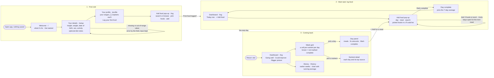

# User flows

The tool is built around three flows: the **first visit**, the **main task** (logging food), and **coming back** (your last 7 days and what to focus on). Each step is its own route. The diagram below is also in `README.md`; when you change one, change both.

## Main task, as one sentence

> I log what I ate today → it joins my last 7 days once I mark the day complete → I come back tomorrow, and the Dashboard shows what's going well and what to eat more of.

## Diagram

## Routes

Shared navigation, shown once setup is done: **Dashboard · History · Profile · FAQ**, with the current page marked.

| Route | What it's for |
|---|---|
| `/` | Welcome card when nothing is saved; goes to the Food log once you're set up |
| `/setup` | Your details: units, height, weight, date of birth (typed as month/day/year, slashes filled in, or picked from a calendar with month and year menus), sex (female, male, non-binary), activity level. Reused, prefilled, to edit them later, plus optional diet notes: eating pattern, allergies or intolerances, and (for female and non-binary) pregnancy or breastfeeding |
| `/profile` | Your profile: a market member card (height, weight and age tiles, sex and activity chips, a maintenance badge, diet-note tags, Edit details) above your daily ranges, each with an ⓘ explanation. `/targets` forwards here |
| `/faq` | How the app works, in short answers grouped by topic (the basics, your week, your ranges, food and logging), including that the ranges are estimates, not medical advice |
| `/log` | **Dashboard.** One page, no tabs: the summary tiles; a **Today** row (calories so far, status, See meals, Mark complete, + Add food; today isn't in the ribbons until it's complete); then the week ribbons, one row per nutrient with a cell per day (in range / under / over / not logged, and brown-bag kraft for a day that's logged but not marked complete) and the average that counts. On a phone the grid shows 3 days at a time with ‹ › arrows, opening on the newest; wider screens show all 7. Clicking a day (header or cell) opens it in a **side panel** (status, Mark complete, highlight tags for what the day did well plus at most one heads-up, foods under Breakfast / Lunch / Dinner / Snacks, collapsed to a count and calories until tapped, each with a + Add, totals); clicking a nutrient expands its weekly detail (bar against target, then each day with its amount and the food that gave the most). **+ Add food** (also opened by `/log?add=1`, e.g. "Log your first food") opens a **pop-up form** over a blurred page. Picked foods collect in a "To add" list (picking one again adds to its amount; Clear empties it); one button adds them to the meal, with Undo, and the pop-up stays open for the next meal, with the day's calories so far, Mark complete and Done at the bottom. The list is kept for the tab, so closing the pop-up or visiting New recipe doesn't lose it ("Add food · 2 picked"). Escape in the search closes only the suggestions. Undo messages show inside an open pop-up or panel (a Meal choice, preset from the meal you clicked or the time of day; a Day dropdown that opens a month calendar limited to today and the 6 days before, search with Foods / Meals & recipes) |
| `/week` | Old address; forwards to `/log` |
| `/history` | Pick a day on an inline month calendar (defaults to today; the 7 days are highlighted) to see high-level stats for the 7 days ending on it: the 7 day badges, a **Calories by day** bar chart against the calorie range (with a table view), and a **Where your calories came from** split of protein, carbs and fat against their ranges. No food-by-food log |
| `/recipes` | Build a recipe from ingredients (a name and an "Add to recipe" search; amounts are set in the list); saved recipes appear under Meals & recipes in Add food and are logged by the serving |
| `/today` | Old address; forwards to `/log` |

## How the 7-day window works

- **The 7-day average is what counts; daily numbers are a guide.** Each nutrient is judged on its average over the last 7 days: the 7 days ending yesterday, until you mark today complete, then the 7 days ending today. An unfinished today never shortens the week. Going out of range on a single day is normal and isn't treated as a miss.
- **Only days you mark complete count.** A day is either complete (you tapped "Mark complete", in the Today row, a day's panel or the Add food pop-up) or not; nothing is marked for you. The average divides by the number of complete days, and the ⓘ next to the grid's Average header says how many count.
  - **Not complete** days (food logged, not marked) are brown-bag kraft cells on the Dashboard (faded on History) and stay out of the averages, so a half-logged day never drags the numbers down.
  - **Unlogged days** are gaps, not zeros.
- **Suggestions refresh daily**, from complete days only, so they never change while you're logging.

### The first week, in stages

| When | What appears |
|---|---|
| Nothing logged yet | The Dashboard is one prompt, "Log what you ate today to start your week.", with a large Add food |
| Food logged, no day complete | The summary says to mark a day complete; the Today row has Mark complete |
| 1–2 complete days | Averages of the days so far; "Suggestions start after 3 complete days… 2 to go." |
| 3+ complete days | Three tiles: Going well, Could improve (a food-group suggestion with foods in bold) and Bigger picture (a habit) |
| 7 complete days | A full week |

## States and errors

- **Nothing logged yet:** one prompt with Add food, never an empty grid.
- **First food logged:** an inline "First food logged" note that says to mark the day complete.
- **Not complete:** brown cells and a "Not complete" chip; left out of the averages until marked.
- **Leaving Add food:** picked foods stay in the "To add" list (saved for the tab), so Escape, Close or visiting New recipe never loses them.
- **Details changed:** a new weight or activity level recalculates the ranges.
- **Sample data:** "Load a sample 2 weeks" on `/profile` asks you to confirm on the page, then fills the 15 days before today with example meals from the built-in foods, scaled to your maintenance calories; all but one "busy day" are marked complete. Days you already logged and today are left alone, and "Clear sample data" removes only the samples (`lib/sample.ts`). It exists so graders and classmates can see the Dashboard, suggestions and History as they look after weeks of use, without entering dozens of foods.
- **Can't save:** if the browser blocks storage (e.g. private browsing), a banner says your data won't be kept.
- **Setup errors:** next to the field and say what to do, e.g. "Enter a height between 4 ft and 7 ft 6 in" or "Enter your date of birth as month/day/year, like 02/19/1995." What you typed stays.
- **Your own food:** name and calories are required, and numbers can't be negative; errors sit by the field and keep what you typed.
- **Remove:** an Undo message right after, shown inside the pop-up or panel you're in.

## What's tracked

The log form always shows food name, date, calories, protein, carbs and fat. The other six nutrients are optional, under "More nutrients"; a blank means *unknown*, not zero, and averages say how many foods they're based on. Quick-add foods fill in all ten, and carry "what it adds" tags (e.g. protein, fiber, vitamin C) instead of good/bad colors. On bars, going over a minimum is never shown in red.

Every nutrient is judged on its 7-day average; the same target is shown as a daily guide on Today.

| Nutrient | Kind | Target (adults, per day) |
|---|---|---|
| Calories | range | maintenance (National Academies 2023 energy equations) ±10% |
| Protein | range | 0.8–1.6 g per kg (higher minimum at 18 and 65+, 2.0 max if very active) |
| Carbs | range | 45–65% of calories, at least 130 g |
| Fat | range | 20–35% of calories (25–35% at 18) |
| Fiber | minimum | 14 g per 1,000 kcal |
| Potassium | minimum | 3,400 mg (M) / 2,600 mg (F) |
| Calcium | minimum | 1,000 mg (1,200 for women 51+ and men 71+) |
| Iron | minimum | 8 mg (M, and F 51+) / 18 mg (F 19–50) |
| Vitamin A | minimum | 900 mcg RAE (M) / 700 mcg RAE (F) |
| Vitamin C | minimum | 90 mg (M) / 75 mg (F) |

Suggestions come from simple rules, with no API. They name real foods from the built-in list that are high in whatever fell short, with a button that logs one serving.
